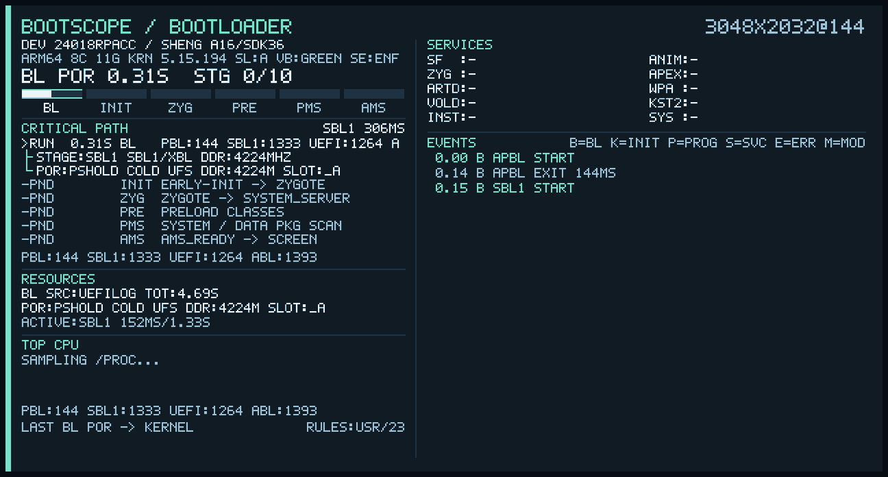

# BootScope

[中文](README.md) | **English**

[](https://developer.android.com)
[](LICENSE)

BootScope is an early-boot on-screen HUD, full-chain boot profiler, and KernelSU WebUI dashboard for modern `arm64-v8a` Android devices, observing startup progression, early faults, and system pressure from bootloader power-on (POR) through `sys.boot_completed`.

The on-device runtime ships as a single static-libstdc++ `C++17` binary (`bootscope`) paired with a Preact WebUI. It leaves `/system` and stock `bootanimation` untouched, collects diagnostics inside one zero-fork native process, and can have its visual overlay disabled or cleanly uninstalled at any time.



## Capabilities

- **Early Native SurfaceFlinger HUD**: Starts on KernelSU `on late-fs` (~2–4s uptime) with an independent `SurfaceFlinger` layer at ~3 FPS, surfacing critical boot stages, `*:E` errors, daemon states, and resource load alongside self-overhead telemetry (`self_cpu_ms`, `self_rss_kb`).
- **Multi-Platform Bootloader Profiling**: Parses Qualcomm UEFI/KPI, `ro.boot.boottime*`, and MediaTek `/proc/bootprof` onto an aligned power-on timeline alongside Android init and framework milestones.
- **Smooth PSI Pressure & Multi-Run Trends**: Merges dense `early-trace.tsv` (`METRIC`) samples with tail `psi.tsv` records using Fritsch-Carlson monotone cubic splines (CPU / IO / MEM) and a continuous pixel-scrubbing ruler, while tracking boot duration trends across reboots.
- **Dedicated Boot Logs Tab**: Provides both severity-grouped triage (`F` / `E` / `M ERR` / `INIT` / `STAGE` / `INFO`) and chronological stage-interleaved timeline views, preserving Java `Caused by:` stack causes with one-tap copy.
- **A/B Run Compare & On-Screen Replay**: Computes milestone and `Bootloader stage deltas (B - A)` across runs, and replays recorded boots on screen with `--bl --pre-sf` via `action.sh`.

## Data Sources & Coverage

| Signal | On-Device Source | Notes |
| --- | --- | --- |
| **Bootloader Stages** | `/dev/logfs/UefiLog0.txt`, `boot_stats` KPI, `ro.boot.boottime*`, `/proc/bootprof` | Automatically selected per SoC/vendor exposure; degrades gracefully when absent |
| **Early Trace & Phases** | `dmesg`, `events`, `/dev/bootscope_early_trace.tsv` | Captures `late-fs` stage transitions, early events, and dense `METRIC` rows |
| **Properties & Services** | `__system_property_foreach` | Polls `init.svc.*`, `ro.boottime.*`, and completion properties without forking |
| **PSI & Process CPU** | `/proc/pressure/{cpu,io,memory}`, `/proc/[pid]/stat` | Measures CPU / IO / MEM stall pressure and `top_cpu` process shares |
| **Faults & Redaction** | `logcat *:E`, init errors, `rules.conf` | Masks matching `redact_key` values in-place (`***`) while keeping error context |

## WebUI & CLI

### WebUI Tabs

| Tab | Purpose |
| --- | --- |
| Overview | Duration summary, bootloader profile, Gantt timeline, smooth PSI curve, and run trend |
| Boot Logs | Grouped severity inspection and stage-interleaved chronological timeline with filtering and copy |
| Compare | Side-by-side milestone deltas and `Bootloader stage deltas (B - A)` between two runs |
| Settings | Toggle HUD overlay (`disable_display`), run `--replay`, prune archives, and edit `rules.conf` |

### Root Shell CLI

```sh
bootscope summary latest                         # Print human-readable summary of latest boot
bootscope inspect-json latest                    # Emit full inspection JSON for scripts/UI
bootscope logs-json latest --level critical      # Filter fatal, module error, and init failure rows
bootscope replay latest --bl --pre-sf            # Replay full boot timeline (BL + pre-SF) on screen
bootscope version                                # Show packaged -rN version and full commit SHA
```

## Compatibility & Installation

- **Target**: `arm64-v8a`, Android 13+ (API 33+).
- **Root Environment**: Full early HUD (`initrc`), WebUI integration, and conditional rebootless hot installs target **KernelSU / SukiSU-Ultra**. On Magisk / APatch, background collection and `late_native` fallback remain available without `late-fs` early injection; archived run directories can also be analyzed offline on PC using the repository's Python CLI.
- **Verified Hardware**: Xiaomi (Qualcomm, Android 16, SukiSU-Ultra); Google Pixel 7 Pro (Tensor, Android 17, KernelSU).

### Setup & Control

1. Download the module ZIP from [Releases](https://github.com/Linoleic/BootScope/releases) (or build from source via [BUILD_EN.md](BUILD_EN.md)) and flash it in KernelSU.
2. Reboot once after initial installation to activate `initrc/bootscope.rc`. Later upgrades automatically request rebootless hot install when `KSU_HAS_HOT_INSTALL=true` and the early entry is active.
3. **Disable Overlay While Keeping Profiling**: Toggle the switch in WebUI **Settings**, or create `/data/adb/bootscope/disable_display`.
4. **Paths & Cleanup**: Custom rules (`rules.conf`) and per-boot archives (`<boot_id>/`, `0700`) live under `/data/adb/bootscope/`, while early KernelSU runtime copies live under `/metadata/vold/ksu/bootscope*`. Removing the module runs `uninstall.sh` on reboot to clear `/metadata/vold/ksu/bootscope*`; `/data/adb/bootscope/` is preserved by default for reuse on reinstall and can be removed manually (`rm -rf /data/adb/bootscope`) if a full wipe is desired.

## Caveats & Diagnostics

- **Early HUD missing or showing `late_native` / `none`**: `bootscope early` resolves private `SurfaceFlinger` symbols dynamically via `dlopen`. Heavily modified OEM `libgui.so` builds may fall back cleanly; check `display-status.txt` and `display-renderer.txt` inside the run directory.
- **Bootloader stages show `N/A`**: Vendor kernels differ in what UEFI/KPI/`bootprof` nodes remain readable. Missing bootloader data does not affect userspace profiling.
- **Reporting issues**: Include your device model, Android version, root manager version, and redacted copies of `display-status.txt` and `display-renderer.txt`.

## License & Documentation

Source code is licensed under **[GNU General Public License v3.0](LICENSE)** with no warranty; the built WebUI bundle includes [Preact](https://preactjs.com/) under the MIT License. Because BootScope executes privileged native code early in boot, verify compatibility for your device and keep backups.

- [Changelog](CHANGELOG.md)
- [Architecture & Contracts](docs/ARCHITECTURE_EN.md)
- [Building, Tests & CI Releases](BUILD_EN.md)
- [GNU GPL v3.0 License](LICENSE)
