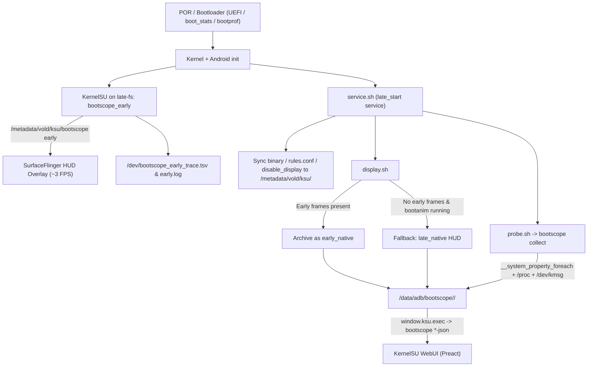

# BootScope 架构与开发者指南

**中文** | [English](ARCHITECTURE_EN.md) | [返回 README](../README.md)

本文档面向希望理解底层实现、调试兼容性或参与二次开发的开发者，说明 BootScope 的总体架构、启动生命周期、ABI 适配机制、数据文件格式、JSON/CLI 契约与构建系统设计。

---

## 1. 代码目录结构

| 目录 / 文件 | 职责说明 |
| --- | --- |
| `core/` | 单一原生 C++17 核心二进制（`bootscope`），采用 `-static-libstdc++` 编译，零第三方运行时依赖 |
| ├─ `main.cpp` | 统一子命令分发入口（`early` / `preview` / `replay` / `collect` / `*-json` / `summary` / `prune` / `config-*` / `rules-*`） |
| ├─ `sf_gui.cpp` / `.h` | 运行时 `dlopen` `libbinder.so` / `libutils.so` / `libgui.so`，对接 `SurfaceComposerClient` 与自适应分辨率几何变换 |
| ├─ `canvas.cpp` / `.h` | 零外部字体依赖的点阵画布引擎与位图字体渲染（RGBA8888 `ANativeWindow_Buffer`） |
| ├─ `renderer.cpp` / `.h` | 启动 HUD / `preview` / `--replay` 状态机、页面调度、自耗指标统计（`getrusage`） |
| ├─ `boot_sources.cpp` / `.h` | 内核态/系统日志流采集（`dmesg`、事件日志、`logcat *:E`、`init` 关键路径），含 `Caused by:` 识别与去重 |
| ├─ `bootloader.cpp` / `.h` | 高通 UEFI/KPI、Android `ro.boot.boottime*` 与联发科 `/proc/bootprof` 解析及 POR 时间线对齐 |
| ├─ `sys_metrics.cpp` / `.h` | 系统压力 PSI、`/proc/[pid]/stat` 高负载进程、CPU 频点、内存/ZRAM、磁盘 I/O 与硬件信息读取 |
| ├─ `early_trace.cpp` / `.h` | `/dev/bootscope_early_trace.tsv` 结构化事件落盘记录器 |
| ├─ `replay_source.cpp` / `.h` | 历史运行目录加载（整合 `early-trace.tsv`、`samples.txt`、`psi.tsv`、`proc.tsv`、`boot-events.tsv`） |
| ├─ `collector.cpp` / `.h` | 后期零 `fork` 原生采样守护进程，利用 `__system_property_foreach` 轮询属性并维护历史目录 |
| ├─ `json_api.cpp` / `.h` | 供 WebUI 消费的结构化 JSON 输出与控制命令处理（含 `psi_series` 合并、日志分组与规则管理） |
| └─ `rules.cpp` / `common.cpp` | `rules.conf` 规则加载、`redact_sensitive_text` 就地脱敏与底层系统辅助函数 |
| `module/` | KernelSU / Root 模块脚本与配置 |
| ├─ `initrc/bootscope.rc` | `on late-fs` 触发服务 `bootscope_early` 执行 `/metadata/vold/ksu/bootscope early` |
| ├─ `customize.sh` | 安装权限设置、`/metadata/vold/ksu/` 二进制与规则同步、条件免重启热安装请求 |
| ├─ `service.sh` | `late_start service` 阶段同步状态并异步拉起 `display.sh` 与 `probe.sh` |
| ├─ `display.sh` | 协调 `early_native` 日志归档、`SurfaceFlinger` 图层状态截取，缺失早期帧时自动回退至 `late_native` |
| ├─ `probe.sh` / `action.sh` / `uninstall.sh` | 后台采样入口、`action.sh` 一键屏幕回放、卸载清理 |
| `webui/` | Preact + TypeScript + Vite 前端 |
| ├─ `src/bridge.ts` | 保持 `window.ksu` 接收者绑定的命令桥（`bridge.exec(...)`）与参数安全引号转义 |
| ├─ `src/format.ts` | 时间/差值格式化、剪贴板回退、Fritsch-Carlson 单调三次样条（`buildMonotoneCubic`）与标尺辅助计算 |
| └─ `src/components/` | `BlCard`、`GanttTimeline`、`PsiCpuCard`、`BootTrendCard`、`LogsView`、`CompareView`、`ReplayBar`、`RunSelect`、`SettingsView` |
| 根目录 Python 脚本 | `build_module.py` / `package_utils.py` 跨平台打包；`analyze_probe.py` / `bootscope.py` / `replay.py` / `report_utils.py` PC 离线分析；`tests/` 单元测试 |

---

## 2. 启动生命周期与数据流

---

## 3. 早期 SurfaceFlinger 原生适配（`core/sf_gui.cpp`）

为了让一个静态链接 C++ 标准的独立二进制能在 `on late-fs` 阶段不重新链接各版本 AOSP 内部头文件就稳定绘制浮层，BootScope 采用 **运行时符号探测 + 多版本 ABI 回退**：

1. **动态加载系统库**：`LibGuiApi::load()` 通过 `dlopen` 加载 `/system/lib64/libbinder.so`、`libutils.so` 与 `libgui.so`。
2. **多签名 C++ Symbol 回退**：针对 Android 13–17（API 33–37）中参数签名变化的导出符号按优先级依次尝试：
   - `SurfaceComposerClient::createSurface`：先查找传引用的 `const gui::LayerMetadata&`，失败则回退到传值的 `gui::LayerMetadata`。
   - `SurfaceComposerClient::getPhysicalDisplayToken`：先查找 `PhysicalDisplayId` 类型参数签名，失败则回退到 `uint64_t`（`m`）签名。
3. **自适应几何与方向旋转**：读取 `SurfaceFlinger` 当前模式宽高与 `ro.surface_flinger.primary_display_orientation`，在 `Geometry::compute` 中计算缩放比例与 `rot_quad`（0/90/180/270°）对应的 `Transaction::setMatrix` / `setPosition`。
4. **低开销节拍**：实时开机 HUD 默认约 `333ms/帧`（~3 FPS），系统资源与进程采样（`collect_sys_metrics` + `trace_metric`）按 `frame_idx % 3 == 0`（约 1 秒）触发一次，并将进程 `self_cpu_ms`、`self_user_ms`、`self_sys_ms` 与 `self_rss_kb` 写入运行摘要。

---

## 4. 多平台 Bootloader 耗时解析（`core/bootloader.cpp`）

BootScope 优先按实时可得的最深层数据源解析 Bootloader 启动时间线，并统一向 POR（通电）基准对齐：

1. **Qualcomm UEFI + KPI**：读取 `/dev/logfs/UefiLog0.txt` 与内核 `boot_stats` KPI 阶段，拆分各初始化阶段与等待时间。
2. **`ro.boot.boottime*` 属性**：解析 `ro.boot.boottime` 与 `ro.boot.boottime_extra` 中的 `STAGE:ms` 键值对（兼容 Pixel/通用设备）。
3. **MediaTek `bootprof`**：解析 `/proc/bootprof` 中的 `PL Boot Time` 与 `LK Boot Time` 等阶段指标。

---

## 5. 设备端目录结构与 `early-trace.tsv` 格式

每次开机会在 `/data/adb/bootscope/<boot_id>/` 下生成独立目录（受 `umask 077` 权限保护，按 `max_history` 自动保留最近 N 次，默认保留 `10` 次；持久化配置保存在 `/data/adb/bootscope/rules.conf` 与 `disable_display`）：

| 文件名 | 用途 |
| --- | --- |
| `early-trace.tsv` | 从 `on late-fs` 起记录的高精度时序轨迹（`ts_ms<TAB>TYPE<TAB>...`） |
| `samples.txt` | `bootscope collect` 周期性收集的 `init.svc.*`、`ro.boottime.*` 与系统属性快照 |
| `psi.tsv` | `/proc/pressure/{cpu,io,memory}` 累计微秒与 `avg10` 时序点 |
| `proc.tsv` | `/proc/[pid]/stat` 进程 CPU ticks、状态与内存可用量采样 |
| `boot-events.tsv` | `events` 日志缓冲区中的关键启动事件（如 `boot_progress_*`） |
| `bootloader-*.txt` | 采集到的原始 Bootloader 日志快照（`uefilog` / `bootprof` / `boottime`） |
| `display-status.txt` / `display-renderer.txt` / `display-compositor.txt` | 显示模式（`early_native` / `late_native` / `none`）、渲染帧统计与 `SurfaceFlinger` 图层状态 |

### `early-trace.tsv` 记录类型
- `LIFE`：生命周期打点（`started`、`first_frame`、`released`）
- `BL` / `BLMETA` / `BLSTG` / `BLEV`：Bootloader 概要、时间线元数据、分段耗时与重要事件
- `PHASE` / `STAGE` / `KV`：核心启动阶段状态机、关键节点里程碑及关键告警指标
- `TAIL`：实时捕获的阶段/错误/模块错误日志（`STAGE` / `ERR` / `MERR` / `INFO`），含完整上下文与 Java `Caused by:` 根因
- `METRIC`：高密度的早期 `cpu,io,mem` PSI 百分比、CPU 频点、内存、磁盘 I/O 与 `top_cpu` 快照

---

## 6. 统一 CLI 与 WebUI JSON 契约

WebUI 通过 [webui/src/bridge.ts](../webui/src/bridge.ts) 中的 `window.ksu.exec(...)`（保留桥接对象接收者以兼容严格 ES Module，避免 `Illegal invocation`）调用 `/data/adb/modules/bootscope/bootscope`：

| 子命令 | 说明 |
| --- | --- |
| `early` / `preview` / `replay` | 屏幕浮层渲染与 `--bl` / `--pre-sf` / `--speed` 全链路回放 |
| `collect [--keep N] [--once] [--out dir]` | 后台原生采集并维护历史运行轮转 |
| `list-json [--limit N]` | 列出历史运行摘要（耗时、BL 耗时、错误数、是否包含早期轨迹与 `self_cpu_ms` / `self_rss_kb`） |
| `inspect-json <target>` | 返回单次启动的完整 BL 分段、甘特阶段、里程碑、`top_cpu`、错误预览及合并后的 `psi_series` |
| `logs-json <target> [--level ...] [--order group\|time]` | 返回分级计数 `log_counts` 与支持关键字/标签筛选的分组或时间线混排日志 |
| `compare-json <a> <b>` | 计算两次启动的阶段差值与 `bl_deltas`（Bootloader 分段差异 `B - A`） |
| `summary <target>` / `prune --keep N` | 终端可读摘要与清理旧运行目录 |
| `config-get` / `config-set <key> <val>` / `rules-get` / `rules-set` | 读写 `disable_display` 与持久化 `rules.conf` |

### `psi_series` 合并与平滑渲染
- 后端 [core/json_api.cpp](../core/json_api.cpp) 优先采用 `early-trace.tsv` 的早期密集 `METRIC` 样本（覆盖 ~2–4s 至动画退出），再补充 `psi.tsv` 尾部区间，自动剔除首条 `avg10` 滑动均值干扰并放宽上限至 `120` 点。
- 前端 [webui/src/format.ts](../webui/src/format.ts) 实现 Fritsch-Carlson 单调三次 Hermite 样条（`buildMonotoneCubic`），将曲线严格约束在 `[0%, 100%]` 内且支持任意水平像素位置连续精确求值（`evalAt`），供 [PsiCpuCard.tsx](../webui/src/components/PsiCpuCard.tsx) 实现无级滑动标尺。

---

## 7. 安全规则、热安装与构建设计

### 规则与脱敏链路
- 读取顺序：优先加载 `/data/adb/bootscope/rules.conf`，回退模块内置 `rules.conf`；KernelSU 安装和开机阶段会将其同步至 `/metadata/vold/ksu/bootscope_rules.conf`。
- 脱敏策略：`redact_sensitive_text` 对匹配 `redact_key` 的敏感键做 **就地脱敏**（将其值替换为 `***`），而非丢弃整行故障日志。

### 条件免重启热安装（`module/customize.sh`）
- 安装阶段向 `/metadata/vold/ksu/` 同步新版 `bootscope` 二进制与 `bootscope_rules.conf`（设置 `0755`/`0644` 及 `u:object_r:ksu_file:s0` 上下文）。
- 当 `KSU_HAS_HOT_INSTALL=true` 且 `/metadata/vold/ksu/modules.rc` 已激活 `/metadata/vold/ksu/bootscope early` 时，自动导出 `MODULE_HOT_INSTALL_REQUEST=true` 实现免重启升级。

### 为什么使用 Python 作为构建与打包脚本
- [build_module.py](../build_module.py) 与 [package_utils.py](../package_utils.py) 仅使用 Python 标准库：
  1. **Windows 开发机与 GitHub Actions `ubuntu-latest` 共用同一套脚本**，无需同时维护 `.ps1` 和 `.sh`。
  2. **精确写入 ZIP 元数据**：通过 `zipfile.ZipInfo` 直接写入 `create_system = 3` 与 Unix 文件权限（`0755`/`0644`），并将文本换行符强制转换为 `LF`，彻底避免 Windows `Compress-Archive` 丢失可执行权限和引入 `CRLF` 的问题。
  3. **可纳入同一套 `unittest` 测试**：[tests/test_bootscope.py](../tests/test_bootscope.py) 直接验证 NDK 版本探测、ZIP 文件权限与换行符。
