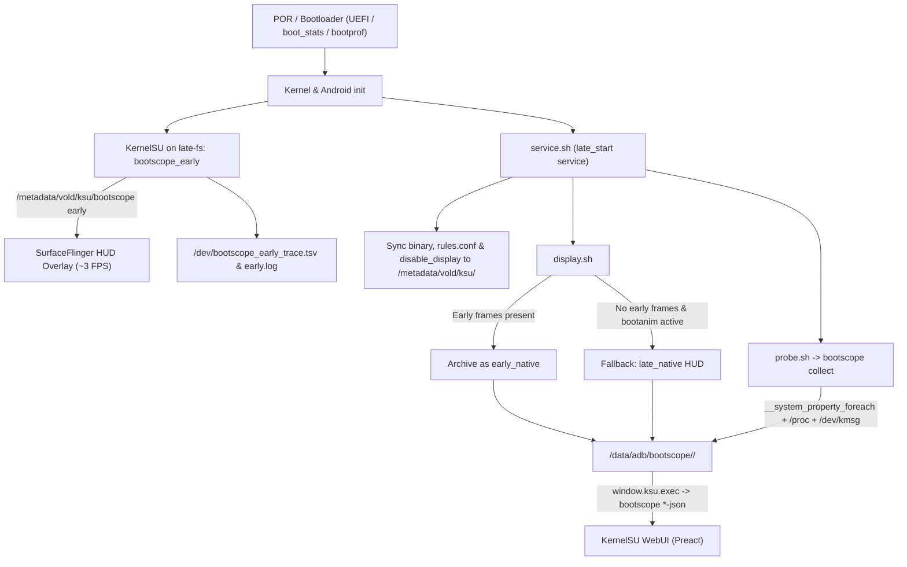

# BootScope Architecture & Developer Guide

[中文](ARCHITECTURE.md) | **English** | [Back to README](../README_EN.md)

This document explains BootScope's internal design, boot-stage lifecycle, runtime SurfaceFlinger ABI adaptation, on-device data layout, JSON/CLI contract, and build pipeline for developers and contributors.

---

## 1. Repository Layout

| Path | Responsibility |
| --- | --- |
| `core/` | Single native C++17 binary (`bootscope`), built with `-static-libstdc++` and zero third-party runtime dependencies |
| ├─ `main.cpp` | CLI subcommand dispatcher (`early`, `preview`, `replay`, `collect`, `*-json`, `summary`, `prune`, `config-*`, `rules-*`) |
| ├─ `sf_gui.cpp` / `.h` | Runtime `dlopen` of `libbinder.so` / `libutils.so` / `libgui.so`, `SurfaceComposerClient` bindings, and responsive rotation geometry |
| ├─ `canvas.cpp` / `.h` | Self-contained RGBA8888 `ANativeWindow_Buffer` drawing engine with built-in bitmap glyph font (`kFontGlyphs`) |
| ├─ `renderer.cpp` / `.h` | HUD / `preview` / `--replay` state machine, screen layout paging, and `getrusage` self-overhead telemetry |
| ├─ `boot_sources.cpp` / `.h` | Ingests `dmesg`, event logs, `logcat *:E`, and init critical paths with Java `Caused by:` detection and trace deduplication |
| ├─ `bootloader.cpp` / `.h` | Multi-platform bootloader stage parser (Qualcomm UEFI/KPI, `ro.boot.boottime*`, MediaTek `/proc/bootprof`) |
| ├─ `sys_metrics.cpp` / `.h` | Reads `/proc/pressure/*`, `/proc/[pid]/stat`, CPU frequencies, memory/ZRAM, disk I/O, and device hardware summary |
| ├─ `early_trace.cpp` / `.h` | Writes structured boot timeline events into `/dev/bootscope_early_trace.tsv` |
| ├─ `replay_source.cpp` / `.h` | Loads archived run directories (`early-trace.tsv`, `samples.txt`, `psi.tsv`, `proc.tsv`, `boot-events.tsv`) |
| ├─ `collector.cpp` / `.h` | Zero-fork post-`late_start` collector polling `__system_property_foreach` and managing `max_history` pruning |
| ├─ `json_api.cpp` / `.h` | WebUI backend endpoints (`list-json`, `inspect-json`, `logs-json`, `compare-json`, `config-*`, `rules-*`) |
| └─ `rules.cpp` / `common.cpp` | `rules.conf` parser, `redact_sensitive_text` in-place masking, and low-level system helpers |
| `module/` | KernelSU / root manager scripts and module metadata |
| ├─ `initrc/bootscope.rc` | KernelSU `on late-fs` service `bootscope_early` executing `/metadata/vold/ksu/bootscope early` |
| ├─ `customize.sh` | Sets permissions, syncs binaries/rules into `/metadata/vold/ksu/`, and requests conditional rebootless hot install |
| ├─ `service.sh` | Late-start sync hook launching `display.sh` and `probe.sh` asynchronously |
| ├─ `display.sh` | Archives `early_native` logs, captures `SurfaceFlinger` layer status, or falls back to `late_native` |
| ├─ `probe.sh` / `action.sh` / `uninstall.sh` | Collector trigger, `--bl --pre-sf` Action button replay, and module uninstall cleanup |
| `webui/` | Preact + TypeScript + Vite dashboard |
| ├─ `src/bridge.ts` | Calls `bridge.exec(...)` while preserving `window.ksu` receiver binding with safe shell argument quoting |
| ├─ `src/format.ts` | Formatting helpers, clipboard fallback, Fritsch-Carlson monotone cubic spline (`buildMonotoneCubic`), and scrub math |
| └─ `src/components/` | `BlCard`, `GanttTimeline`, `PsiCpuCard`, `BootTrendCard`, `LogsView`, `CompareView`, `ReplayBar`, `RunSelect`, `SettingsView` |
| Root Python Tools | `build_module.py` / `package_utils.py` cross-platform packager; `analyze_probe.py` / `bootscope.py` / `replay.py` / `report_utils.py` PC CLI suite; `tests/` |

---

## 2. Boot Lifecycle & Data Flow

---

## 3. Runtime SurfaceFlinger ABI Adaptation (`core/sf_gui.cpp`)

To render directly to Android's `SurfaceFlinger` at `on late-fs` without linking against version-locked AOSP internal headers, `bootscope` resolves symbols dynamically at runtime:

1. **Dynamic Library Loading**: `LibGuiApi::load()` opens `/system/lib64/libbinder.so`, `libutils.so`, and `libgui.so` via `dlopen`.
2. **Mangled C++ Symbol Fallbacks (Android 13–17 / API 33–37)**:
   - `SurfaceComposerClient::createSurface`: Probes reference `const gui::LayerMetadata&` first, falling back to value `gui::LayerMetadata`.
   - `SurfaceComposerClient::getPhysicalDisplayToken`: Probes `PhysicalDisplayId` overload first, falling back to `uint64_t` (`m`).
3. **Orientation & Rotation Geometry**: Queries active display mode dimensions and `ro.surface_flinger.primary_display_orientation`, mapping logical canvas coordinates through `rot_quad` (0/90/180/270°) into `Transaction::setMatrix` / `setPosition`.
4. **Low-Overhead Pacing**: Live HUD updates run at ~333 ms per frame (~3 FPS), sampling full system/PSI metrics every 3 frames (~1s) while recording process `self_cpu_ms`, `self_user_ms`, `self_sys_ms`, and `self_rss_kb`.

---

## 4. Multi-Platform Bootloader Profiling (`core/bootloader.cpp`)

BootScope selects the richest bootloader source available and aligns stages onto a unified power-on timeline:

1. **Qualcomm UEFI + Kernel KPI**: Combines `/dev/logfs/UefiLog0.txt` and kernel `boot_stats` KPI counters.
2. **`ro.boot.boottime*` Properties**: Parses `STAGE:ms` pairs from `ro.boot.boottime` and `ro.boot.boottime_extra` (Pixel / generic devices).
3. **MediaTek `bootprof`**: Extracts `PL Boot Time` and `LK Boot Time` from `/proc/bootprof`.

---

## 5. On-Device Data Layout & `early-trace.tsv` Schema

Each boot creates `/data/adb/bootscope/<boot_id>/` (`umask 077`), rotated automatically up to `max_history` (default `10`). Persistent overrides live at `/data/adb/bootscope/rules.conf` and `/data/adb/bootscope/disable_display`.

| File | Purpose |
| --- | --- |
| `early-trace.tsv` | Millisecond-indexed boot timeline recorded from `late-fs` (`ts_ms<TAB>TYPE<TAB>...`) |
| `samples.txt` | Periodic snapshots of `init.svc.*`, `ro.boottime.*`, and boot properties |
| `psi.tsv` | Raw `/proc/pressure/{cpu,io,memory}` cumulative microseconds and `avg10` |
| `proc.tsv` | Per-PID ticks, scheduler states, and memory availability samples |
| `boot-events.tsv` | System event milestones (e.g. `boot_progress_*`) |
| `bootloader-*.txt` | Raw bootloader logs captured during boot (`uefilog`, `bootprof`, or `boottime`) |
| `display-status.txt` / `display-renderer.txt` / `display-compositor.txt` | Display mode (`early_native`, `late_native`, `none`), frame stats, and compositor layer visibility |

### `early-trace.tsv` Row Types
- `LIFE`: Renderer lifecycle (`started`, `first_frame`, `released`)
- `BL` / `BLMETA` / `BLSTG` / `BLEV`: Bootloader summary, timeline metadata, stage breakdowns, and events
- `PHASE` / `STAGE` / `KV`: Critical path phase transitions, stages, and alert key-values
- `TAIL`: Deduplicated trace lines (`STAGE`, `ERR`, `MERR`, `INFO`), including Java `Caused by:` stack causes
- `METRIC`: Dense early `cpu,io,mem` PSI percentages, frequencies, memory, disk I/O, and `top_cpu`

---

## 6. Unified CLI & WebUI JSON API Contract

WebUI invokes `/data/adb/modules/bootscope/bootscope` via [webui/src/bridge.ts](../webui/src/bridge.ts) (`bridge.exec(...)`, keeping the `window.ksu` receiver bound in strict ES modules):

| Subcommand | Description |
| --- | --- |
| `early` / `preview` / `replay` | On-screen HUD overlay and `--bl` / `--pre-sf` / `--speed` run replay |
| `collect [--keep N] [--once] [--out dir]` | Native collector daemon and history rotation |
| `list-json [--limit N]` | Historical run list (duration, bootloader total, error count, early-trace flag, self overhead) |
| `inspect-json <target>` | Full run breakdown: BL profile, Gantt phases, milestones, `top_cpu`, preview errors, and merged `psi_series` |
| `logs-json <target> [--level ...] [--order group\|time]` | Level counts (`log_counts`) and filtered logs in severity-grouped or chronological stage-interleaved order |
| `compare-json <a> <b>` | Milestone deltas plus `bl_deltas` bootloader stage diff (`B - A`) |
| `summary <target>` / `prune --keep N` | Human-readable CLI summary and old run cleanup |
| `config-get` / `config-set <key> <val>` / `rules-get` / `rules-set` | Read/write `disable_display` state and persistent `rules.conf` |

### `psi_series` Merging & Smooth Spline Rendering
- [core/json_api.cpp](../core/json_api.cpp) merges early `trace_metrics` rows with tail `psi_points` (skipping leading `avg10` moving-average distortion), deduplicates timestamps, and raises the series cap to `120`.
- [webui/src/format.ts](../webui/src/format.ts) computes a Fritsch-Carlson monotone cubic Hermite spline (`buildMonotoneCubic`) bounded cleanly to `[0%, 100%]` with continuous horizontal evaluation (`evalAt`) driving the pixel-smooth ruler in [PsiCpuCard.tsx](../webui/src/components/PsiCpuCard.tsx).

---

## 7. Security Redaction, Hot Install & Build Rationale

- **Rule Precedence & Redaction**: `/data/adb/bootscope/rules.conf` overrides the bundled `rules.conf` and is synced to `/metadata/vold/ksu/bootscope_rules.conf`. Matching `redact_key` entries are masked in-place (`***`) via `redact_sensitive_text` so diagnostic lines remain debuggable without leaking identifiers.
- **Conditional Hot Install**: `module/customize.sh` updates `/metadata/vold/ksu/bootscope` and sets `MODULE_HOT_INSTALL_REQUEST=true` when `KSU_HAS_HOT_INSTALL=true` and `/metadata/vold/ksu/modules.rc` already registers `bootscope early`.
- **Why Pure-Python Build Tooling**: [build_module.py](../build_module.py) and [package_utils.py](../package_utils.py) rely strictly on the Python standard library so Windows developers and `ubuntu-latest` CI run identical build logic, write exact Unix `0755`/`0644` ZIP attributes and `LF` line endings via `zipfile.ZipInfo` (avoiding Windows `Compress-Archive` permission/CRLF pitfalls), and integrate directly with [tests/test_bootscope.py](../tests/test_bootscope.py).
